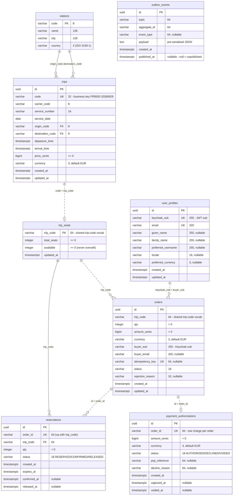

<!-- #DA ELIMINARE -->
> **⚠️ TO BE DELETED (#DA ELIMINARE)** — Schema/ER consolidated into the application repo README.md (§7). Kept for now; remove in one pass when the repo is final (grep `#DA ELIMINARE`).

## Summary
Advances the feature line from the `dev` merge-base (`06da3aa`) onto `dev`. Linear stack of 5 commits:

- `d3373dc` refactor: extract DTOs to `dto/` + centralized error handling
- `651aab4` feat: small fixes  — **backend-fixes** tip
- `fafdbbc` feat: add Keycloak auth (users service, resource servers, frontend login)
- `21c2c99` feat(frontend): containerize debug SPA, target kind Keycloak  — **feat/keycloak-auth** tip
- `e8ff637` refactor: Postgres/Testcontainers DB refactor + service interfaces

## Branch inclusion
`backend-fixes` (`651aab4`) and `feat/keycloak-auth` (`21c2c99`) are both ancestors of this branch, so this PR includes all of their commits. Neither is currently in `dev`.

## Notes
- `dev` has diverged: it carries **12 commits not in this branch** (common ancestor `06da3aa`), so this is a 3-way merge — review for conflicts.
- Backend verified: all five service test suites pass on Testcontainers PostgreSQL. Frontend changes were not built/tested here.

## Database schema (ER diagram)
Per-service schemas (database-per-service). **Solid** lines are real foreign keys within a service's schema; **dashed** lines are logical cross-service links over the shared `code` / `order_id` vocabulary (no physical FK).

## Test plan
- [ ] CI green on the PR
- [ ] Resolve any merge conflicts with `dev`
- [ ] Smoke-test the money path after merge
