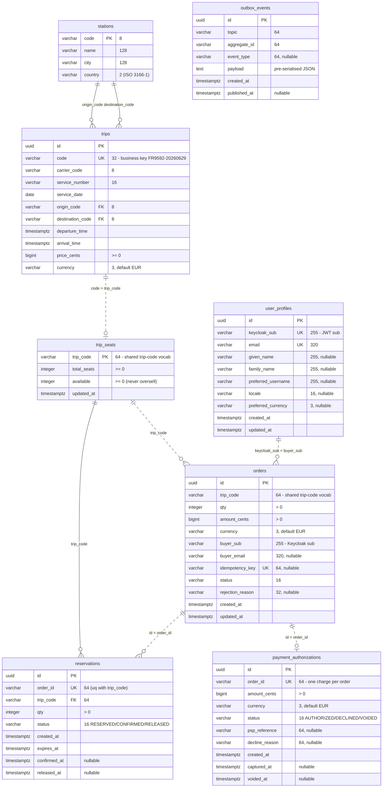

# EuroTransit Marketplace — Application repository (g03)

Source for the six cooperating services, their tests, the CI workflow and the `justfile`. This is the
**application** half of the two-repository GitOps model; the **configuration** repository holds the Helm chart,
platform bootstrap, Argo CD `Application`s, SLO/alert definitions and the team docs.

> CI builds and tests images, pushes **immutable** images (tagged with the commit SHA) to ACR, and bumps the
> image tag in the configuration repository. **CI never holds cluster credentials** — Argo CD reconciles the
> cluster to match Git.

This README is the app-side **knowledge base** (design + implementation choices, defensible at the oral). It is
one of the three ground documents, together with the configuration repo's `README.md` and
`docs/traccia/FASI_PROGETTO.md` (the phase roadmap).

Stack: **Kotlin 2.2.21 / Spring Boot 4.0.3 / JDK 21**, package root `it.g03.<service>`, Gradle (one independent
project per service), PostgreSQL via CloudNativePG, messaging over **Kafka (Strimzi)**. The money path is
**asynchronous**: an orchestrated **command/reply saga on Kafka**. Exact versions: see the config repo's
`docs/version-compatibility.md`.

---

## 1. The six services

| Service | Package | Role | On the money path? |
|---|---|---|:---:|
| **catalog** | `it.g03.catalog` | public read API for trips (staleness-tolerant) | no |
| **orders** | `it.g03.orders` | **orchestrator** of the saga (reply-driven state machine) + transactional outbox | yes |
| **inventory** | `it.g03.inventory` | the **contended** resource: atomic reservation (never-oversell), two-phase reserve→confirm | yes |
| **payments** | `it.g03.payments` | idempotent authorization (no double-charge), two-phase authorize→capture; PSP **mock** behind a clean interface | yes |
| **notifications** | `it.g03.notifications` | fully-async sink; degrades without breaking checkout | no |
| **users** | `it.g03.users` | Keycloak-backed profiles (the JWT subject) | no |

The **money path** (place order → reserve inventory → authorize payment → confirm) is the critical path; SLOs,
dashboards, tracing and chaos experiments all centre on it.

## 2. Anatomy of a service (the layers)

Each request flows top-to-bottom; a service exposes only the layers it needs.

```
   HTTP in                    Kafka in
      │                          │
 ┌────▼───────┐        ┌─────────▼─────────┐
 │ Controller │        │ *CommandListeners │   ← EDGE (talks to the outside world)
 │ (@RestController)    │ *ReplyListeners   │
 └────┬───────┘        │  (@KafkaListener)  │
      └──────────┬──────────────┘
            ┌────▼─────┐
            │ Service  │   ← LOGIC (business decisions, @Transactional; the outbox row is appended here)
            └────┬─────┘
            ┌────▼─────┐
            │Repository│   ← DATA (Spring generates the queries)
            └────┬─────┘
            ┌────▼─────┐
            │  Entity  │   ← a table row (@Entity)
            └──────────┘
```

**Layering rule (mandatory): Controller → Service → Repository.** A controller is HTTP-only (DTOs, status codes,
exception mapping) and **never** calls a repository directly. The service is the unit of behaviour (business logic,
transactions, idempotency, and where the outbox row is appended). Repositories are Spring Data interfaces with no
logic beyond queries. **Never expose JPA entities** — map to request/response DTOs at the boundary; validate request
bodies with Bean Validation (`@Valid`); paginate any list endpoint (`Pageable` + `Specification`, return `Page<Dto>`).

**Suffix dictionary** — open a file and you know what it is: `…Controller` (HTTP in), `…CommandListeners` /
`…ReplyListeners` / `…Listener` (Kafka in), `…Service` (logic, `@Transactional`), `…Repository` (Spring Data),
entities (`Order`, `Reservation`, …), `SagaEvents`/`…Events` (Kafka message shapes + `object Topics`), `Outbox`
(appends the event in the same tx as the state change; drained by Debezium). *(Async note: there is no `Gateways.kt`
sync HTTP client and no in-app `OutboxPublisher` relay any more — internal calls travel over Kafka and the
outbox→Kafka publish is done by Debezium; see §5.)*

## 3. The money path — async Kafka command/reply saga (Pillar A)

Orders accepts the POST **synchronously with `202 Accepted`** (persisting `Order(PENDING)` + the `order-placed`
outbox row in **one** transaction), then **consumes its own `order-placed`** ("listen-to-yourself") and starts the
saga. From there everything is **reply-driven**: Orders emits a **command**, the target service acts and answers with
a **reply**, and the reply advances the state machine. There is **no synchronous HTTP call on the money path.**

Contracts (Kafka topics, created by Strimzi in the config repo):

| Direction | Topic | Meaning |
|---|---|---|
| event | `order-placed` | saga trigger (self-consumed) |
| command → inventory | `reserve-seats` | hold the seats |
| reply ← inventory | `reservation-result` | `RESERVED` \| `SOLD_OUT` |
| command → payments | `authorize-payment` | hold funds (auth only, no capture) |
| reply ← payments | `payment-result` | `AUTHORIZED` \| `DECLINED` |
| command → inventory | `confirm-seats` | turn the hold into a firm sale |
| reply ← inventory | `seats-confirmed` | `CONFIRMED` \| `EXPIRED` |
| command → payments | `capture-payment` | capture the held funds (final step) |
| reply ← payments | `payment-captured` | funds captured |
| compensation → inventory | `release-seats` | on `DECLINED`: give the seats back |
| compensation → payments | `cancel-authorization` | on `EXPIRED`: release the funds hold (no capture ⇒ no refund) |
| terminal event | `order-confirmed` / `order-rejected` | final outcome |
| event (informational) | `notification-requested` | tell Notifications to inform the user |
| dead-letter (per service) | `orders-dlt` / `inventory-dlt` / `payments-dlt` | poison/exhausted messages |

**State machine** (`OrderStateMachine`; every transition is `@Transactional`, **status-guarded** and idempotent —
the state change and the appended command/event commit or roll back together):

```
PENDING ──order-placed──▶ [emit reserve-seats, stay PENDING]
  │ reservation-result
  ├─ RESERVED  ──▶ RESERVED   [emit authorize-payment]
  └─ SOLD_OUT  ──▶ REJECTED (SOLD_OUT)
RESERVED
  │ payment-result
  ├─ AUTHORIZED ─▶ AUTHORIZED [emit confirm-seats]
  └─ DECLINED  ──▶ [release-seats] + REJECTED (PAYMENT_DECLINED)
AUTHORIZED
  │ seats-confirmed
  ├─ CONFIRMED ──▶ [emit capture-payment, stay AUTHORIZED]
  └─ EXPIRED   ──▶ [cancel-authorization] + REJECTED (RESERVATION_EXPIRED)
AUTHORIZED
  │ payment-captured ──▶ CONFIRMED  [emit order-confirmed + notification-requested]   ← happy end
```

Topology (all async over Kafka; each service owns its DB + an outbox read by Debezium):

```mermaid
flowchart LR
    client([Client]) -->|/api/catalog| C["Catalog<br/>(off money path)"]
    client -->|/api/orders 202| O["Orders<br/>(saga orchestrator)"]
    O <-. "commands / replies" .-> K{{"Kafka (Strimzi)"}}
    I["Inventory"] <-. .-> K
    P["Payments"] <-. .-> K
    K -. "notification-requested" .-> N["Notifications<br/>(sink)"]
    O --- ODB[("ordersdb + outbox")]
    I --- IDB[("inventorydb + outbox")]
    P --- PDB[("paymentsdb + outbox")]
    DBZ["Debezium (Kafka Connect)"] -. "reads the outbox WAL" .-> ODB & IDB & PDB
    DBZ -. "publishes" .-> K
```

**Why it is built this way.** *202 + async saga:* the user gets a **durable** ack immediately; reserve/authorize/
confirm proceed off the request thread. An optional `Idempotency-Key` makes a retried POST **replay** the same order
instead of creating a duplicate; the buyer's identity comes from the **JWT**, never the body. *Reply-driven +
listen-to-yourself:* an order advances only on real replies — no coupling to a downstream's instantaneous
availability (if a downstream is down, the command waits in its queue). *Two-phase + compensations:* `reserve→confirm`
and `authorize→capture` allow clean compensations (`release-seats` on decline, `cancel-authorization` on an expired
hold — no capture ⇒ no refund). *Notifications off the money path:* checkout succeeds even if Notifications is fully
down.

## 4. Correctness under contention & idempotency (Pillar B)

- **Never-oversell** = an atomic conditional `UPDATE … WHERE available >= :qty` on the seat counter: the row-lock
  serializes concurrent buyers, the loser sees 0 rows = sold out. No application-level lock. Backed by a DB `CHECK`.
- **No double-charge / effective exactly-once** = idempotency via **`UNIQUE(order_id)`** (payments) and
  **`UNIQUE(order_id, trip_code)`** (inventory): Kafka's at-least-once is safe because a redelivery is a no-op.
- **Idempotent transitions** = every state-machine handler **guards on status** before acting: a duplicated or
  out-of-order reply against a terminal/wrong state is a clean no-op (no double command, no flip of a terminal order).
- **`@Version` race** = optimistic locking on `Order`: if the timeout sweeper (re-drive) and an in-flight reply
  transition the same order, the loser rolls back with `ObjectOptimisticLockingFailureException`, which `OrderSaga`
  absorbs as a benign no-op (the other already advanced). Any other exception propagates to the error handler → DLT.

## 5. Transactional outbox + Debezium CDC (Pillar A)

Each money-path service (orders, inventory, payments) has an **outbox** table. Inside its `@Transactional`, the
service appends the event/reply to the outbox **in the same transaction** as the state change: if the DB commits,
the event exists; if it rolls back, it doesn't (no ghost events, no lost events). The outbox→Kafka publish is
**Debezium CDC** (log-based): the config repo runs **Strimzi Kafka Connect (3 replicas)** + one connector per
service, reading the **WAL** (CloudNativePG in `wal_level=logical`) and publishing to the topics. **No in-app polling
relay** — reading the log is the production-grade pattern. Recovery: a crashed service resumes by reading the topics
(at-least-once + idempotent handlers).

**Cross-Kafka tracing (Pillar D).** The event producer is **Debezium, not the `KafkaTemplate`**, so in-process
producer instrumentation can't propagate context. Instead `Outbox.append` captures the current **W3C `traceparent`**
and persists it as a **column of the outbox row (same tx)**; Debezium's Outbox Event Router maps it to a **Kafka
header**, and consumers continue it with `spring.kafka.listener.observation-enabled: true`. A NULL `traceparent`
(e.g. a sweeper re-drive with no active span) ⇒ the consumer starts a fresh trace — never invent context.
**Saga-completion SLI** (a `202` is not "done"): `orders_confirmed_total` and `orders_rejected_total{reason}` are
incremented in the **terminal** transitions (a rejection is a *completed* saga: SOLD_OUT/DECLINED are correct
outcomes), plus a gauge `orders_overdue_nonterminal` from the timeout sweeper (stuck orders are visible even at zero
traffic). The alert is on the **terminal-ratio** and the gauge, never on the confirmed-ratio.

## 6. Resilience in the code (Pillar C)

With the async cutover, the **synchronous** Orders→Payments patterns (circuit breaker / bulkhead / retry) were
**retired** (there is no sync call any more). Resilience now lives as:

- **Edge backpressure** — `@RateLimiter(name="orders-intake")` (resilience4j AOP) on `POST /api/orders`: within
  budget the body runs and returns 202; over budget it throws `RequestNotPermitted` **before** touching DB/outbox →
  **429 + Retry-After**. Controlled refusal, not a queue.
- **Bounded retry + dead-letter** — on the consumers: `DefaultErrorHandler` + `FixedBackOff(500ms, 3)` +
  `DeadLetterPublishingRecoverer` → **a DLT per service**. The offset commits only on a clean return
  (`enable-auto-commit=false`); a message that keeps failing goes to the DLT instead of head-of-line-blocking the
  partition. Bounded ⇒ no retry storm.
- **Liveness backstop** — `OrderTimeoutSweeper` (`@Scheduled`): a non-terminal order whose `updatedAt` passes the
  deadline (a lost reply: Kafka partition, consumer crash, DLT) is **re-driven** by re-emitting the command for its
  current state (idempotent downstream). Each order runs in its own try/catch, so one failure doesn't block the rest.
- **Where the breaker returns** — only around a **synchronous external egress** (a real PSP): there
  `@CircuitBreaker/@Retry/@TimeLimiter` (Boot 4, `resilience4j-spring-boot4` + aspectj). See the async-rework note.

> **In flight (branch `async-rework`, not yet on `main`):** PayPal enters as a **real PSP** behind the
> `PaymentGateway` interface (the mock stays selectable) → the concrete home of the egress breaker above; plus an
> **SSE** stream of saga status (Notifications → the SPA) and **multi-leg orders + a checkout window**. This README's
> money-path description is the current `main` (mock PSP); it is updated when that branch merges.

## 7. Database schema (database-per-service)

Solid lines = real foreign keys within a service's schema; dashed = logical cross-service links over the shared
`code` / `order_id` vocabulary (no physical FK — services never touch each other's tables).



**Schema discipline:** **Flyway owns the schema** (migrations in `db/migration/V*__*.sql`, scoped to each service's
schema); Hibernate runs `ddl-auto: validate` only. Dev uses one `eurotransit` DB with a schema per service; prod
gives the money-path services (`orders`, `inventory`, `payments`) a **dedicated CloudNativePG cluster** for
blast-radius isolation. Notifications is stateless (no schema).

## 8. Build, test, run

Each service is an **independent Gradle project** with its own wrapper — no root build, so services compile/test in
isolation (CI builds only what changed). Tests use **Testcontainers PostgreSQL** (ephemeral real Postgres + real
Flyway, faithful to `UNIQUE`/`CHECK`/never-oversell) — **no H2**. Kafka listeners/publishing are disabled in tests
via properties; the outbox is drained externally by Debezium, so consumer logic is tested with fakes.

```bash
just test <svc>        # one service's tests (Testcontainers spins up Postgres)
just test-all          # every service
just build <svc>       # build the runnable jar (runs tests)
just run <svc>         # run locally on :8080 (needs Postgres + Kafka)
just verify <svc>      # local Definition-of-Done: build → test → image → run → readiness probe
just image <svc> [tag] # build a container image (linux/amd64)
```

Config is env-driven with local-dev defaults (`${VAR:default}`): `DB_*`, `KAFKA_BOOTSTRAP`,
`MANAGEMENT_OPENTELEMETRY_TRACING_EXPORT_OTLP_ENDPOINT`, app tunables (`app.unit-price-cents`,
`inventory.reservation.ttl`, …). The `cluster` profile (`SPRING_PROFILES_ACTIVE=cluster`) adds in-cluster hardening
(quiet SQL, hidden actuator health details, ECS JSON logs); in-cluster the `DB_*` values come from the
CloudNativePG-generated secret. Secrets reach the app as env vars, in Git only as SealedSecrets.

## 9. CI/CD & GitOps

`.github/workflows/ci.yml`: detect changed services (path filter) → per-service matrix build & test → push an
immutable SHA-tagged image to ACR → bump that tag in the **config repo** `values.yaml`. Argo CD reconciles. **CI
never touches the cluster**; a config-repo-scoped PAT is the least-privilege bridge. Two progressive-delivery
strategies are demonstrated on `orders` (canary + blue/green) — see the config repo.

## 10. Known hardening backlog (non-blocking)

Genuine open items distilled from the earlier gap-analysis (most of its findings are now resolved: Resilience4j
wired, docs authored, compensation added, restock race fixed with `@Version`, Testcontainers, timeout sweeper):
- **Supply-chain / DevSecOps:** no SAST / dependency scan / image signing / SBOM in CI yet.
- **CI → config-repo `main` push has no PR gate** (a write-scoped PAT commits directly) — reasoned about in the
  configuration repo's `docs/agent-threat-model.md`.

## 11. References

- Infra / GitOps / observability / progressive delivery / SLOs / chaos: **configuration repo `README.md`**.
- Phase-by-phase roadmap: `../capstone-configuration-g03/docs/traccia/FASI_PROGETTO.md`.
- Async cutover rationale (Pillar A written analysis): `docs/sync-vs-async-resilience.md`.
- Agent mistakes (graded): `../capstone-configuration-g03/docs/agent-log.md`.
